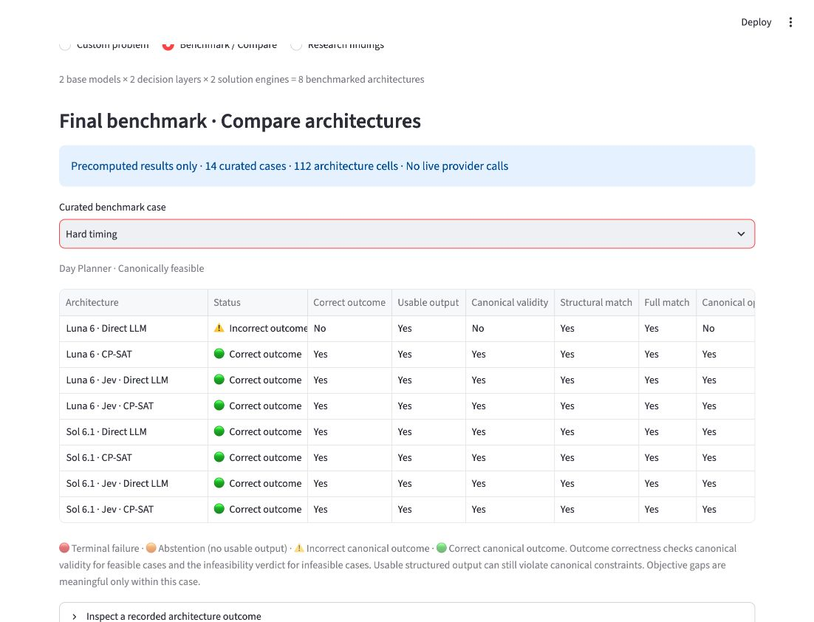
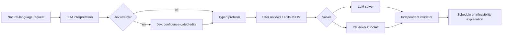

# AI Decision Optimizer

**An app that turns plain-English scheduling requests into constraint-based schedules, plus a benchmark that compares 8 ways of combining LLMs and a traditional optimization solver to do it.**

[**Try the live demo →**](https://ai-decision-optimizer.streamlit.app/)



Python · OpenAI Structured Outputs · Google OR-Tools (CP-SAT) · Pydantic · TypeSafe Jev · Streamlit · pytest · uv

---

## What it does

Describe a scheduling problem in natural language, for example *"I have a 2pm meeting, need to do laundry, and want to work out before dinner"* or *"Staff these five shifts; Maria can't work weekends."* The app will:

1. **Interpret** the request with an LLM into a typed, validated problem definition (tasks, constraints, preferences).
2. **Optionally refine** ambiguous judgments (is this a hard requirement or a preference?) with a probabilistic decision model.
3. **Let you review and edit** the interpretation before anything is solved.
4. **Solve** it with either the LLM itself or a constraint-programming solver (OR-Tools CP-SAT).
5. **Independently validate** the result and explain infeasibility when no valid schedule exists.

It supports two domains: a **Day Planner** (personal tasks, fixed events, ordering, time preferences) and a **Workforce Scheduler** (shift coverage, availability, max hours, rest rules, fairness).

## The question

When you build an AI system for a problem with hard rules, which design choices actually matter?

| Choice | Options |
| --- | --- |
| Language model | GPT-6 Luna (smaller, cheaper) or GPT-6.1 Sol (larger) |
| Decision layer | None, or TypeSafe Jev reviewing ambiguous judgments |
| Solver | Let the LLM produce the schedule, or hand it to OR-Tools CP-SAT |

That's **2 × 2 × 2 = 8 architectures**, each run on **14 curated benchmark cases** and scored against ground-truth answers.

## Key findings

- **A deterministic solver makes a weaker model competitive.** Swapping the LLM solver for CP-SAT raised the smaller model from 8/14 to 11/14 correct, and never made a result worse. Every valid CP-SAT schedule matched the known optimum (42/42).
- **Model choice mattered most for correctness.** The larger model was correct in 52 of 56 runs versus 39 of 56 for the smaller one, at roughly 15× the cost per request.
- **With a strong model, the solver mostly buys speed and cost.** Sol 6.1 got the same accuracy with either solver, but CP-SAT was about a third faster and 30% cheaper.
- **Adding a second "judgment" model didn't help.** Jev's edits never fixed a wrong answer, and several made the interpretation less accurate. The bottleneck was the LLM missing details during interpretation, which a downstream reviewer can't recover.

| Architecture | Correct (of 14) | Median latency | Median cost |
| --- | ---: | ---: | ---: |
| Luna · LLM solver | 8 | 8.1 s | $0.00045 |
| Luna · CP-SAT | 11 | 4.9 s | $0.00035 |
| Luna · Jev · LLM solver | 9 | 10.1 s | $0.00046 |
| Luna · Jev · CP-SAT | 11 | 5.1 s | $0.00035 |
| Sol 6.1 · LLM solver | 13 | 11.6 s | $0.0075 |
| **Sol 6.1 · CP-SAT** | **13** | **7.7 s** | **$0.0052** |
| Sol 6.1 · Jev · LLM solver | 13 | 11.8 s | $0.0074 |
| Sol 6.1 · Jev · CP-SAT | 13 | 8.0 s | $0.0052 |

Costs estimate OpenAI usage and exclude unknown timeout billing.

This is a small benchmark (14 cases per architecture, with shared extraction across variants), so the findings are descriptive rather than conclusive. The [full analysis](benchmark_results/final_sol61_v2/analysis/analysis_report.md) and [methodology](docs/benchmark_methodology.md) cover the details, including calibration of Jev's confidence scores.

## How it works



Both solvers receive the same typed problem, so the comparison isolates *who solves* from *how the request was understood*. Jev answers a fixed set of yes/no, multiple-choice, and 1–5 rating questions (e.g. "is this time a firm requirement?") and only overrides the LLM when its confidence is at least 0.7.

## Engineering highlights

- **Typed boundaries everywhere.** LLM output is parsed into Pydantic models; anything malformed fails loudly instead of flowing downstream.
- **Independent validation.** Every schedule is checked by a separate validator, and benchmark results are additionally scored against a canonical specification, so a solver can't grade its own homework.
- **Reproducible benchmark pipeline.** Raw results are immutable; a deterministic reconciliation and analysis step produces every number above, with provenance recorded. Benchmark runs are resumable and handle API failures and timeouts.
- **Offline-first UI.** The Compare and Research views read committed results and need no API keys, so the demo works without spending money.
- **325 tests** covering the solvers, validators, parsing, Jev integration, benchmark analysis, and UI behavior, with no paid API calls.

## Running locally

```bash
cp .env.example .env          # add OPENAI_API_KEY; TYPESAFE_API_KEY is optional
uv sync --extra test
uv run streamlit run app.py
uv run pytest                 # run the test suite
```

Without `OPENAI_API_KEY` you can still browse the benchmark results. Without `TYPESAFE_API_KEY`, Jev is disabled and the app explains why.

## Project layout

```
app.py                      Streamlit app
decision_optimizer/
  dayplan/, shift_schedule/ Schemas, CP-SAT models, and validators per domain
  parsing/                  LLM interpretation into typed problems
  direct_solver.py          LLM-as-solver engine
  jev.py                    Jev question generation and confidence gating
  benchmark.py, evaluation.py, experiment.py   Benchmark runner and scoring
scripts/                    Run, reconcile, and analyze the benchmark
benchmark_results/          Committed raw and reconciled results and analysis
docs/                       Methodology and audit write-ups
tests/
```

## Further reading

- [Benchmark methodology](docs/benchmark_methodology.md): case design, scoring rules, and what the results do and don't show
- [Final analysis report](benchmark_results/final_sol61_v2/analysis/analysis_report.md): full metrics, per-question-type breakdowns, and calibration
- [Project plan](project_plan.md): original research design and phase plan
